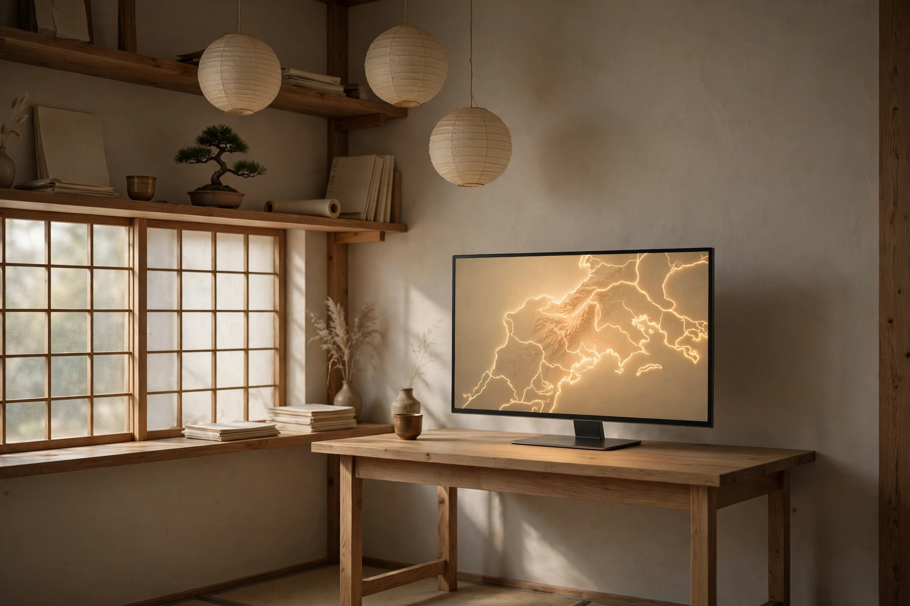
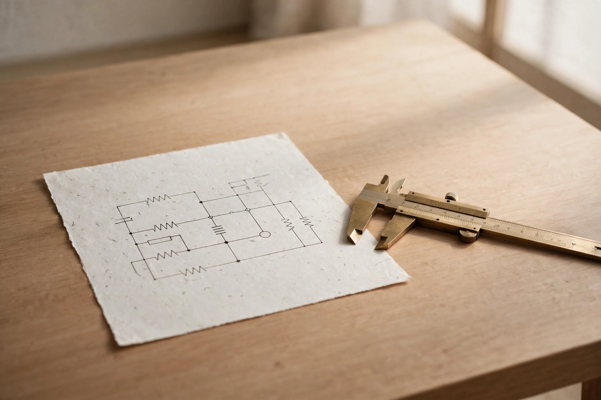
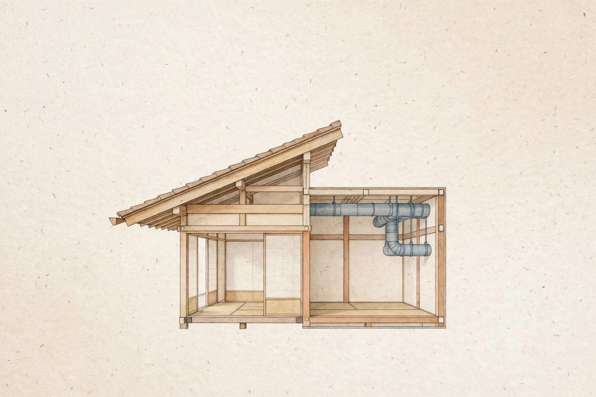
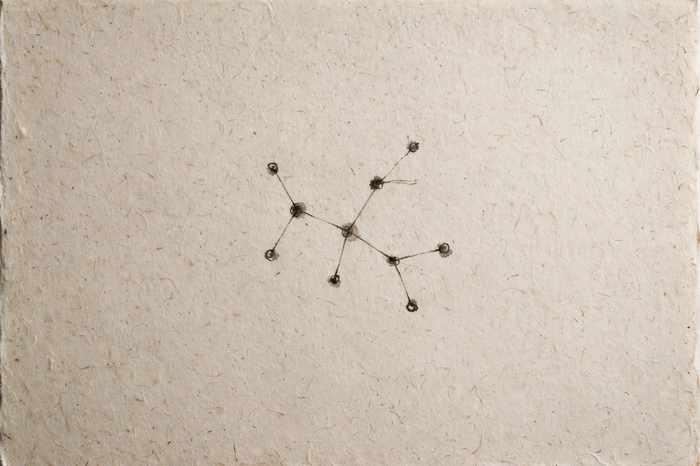

# Tri Adi Setiawan
### Darren Lieu

I run **Darren Labs**, an agentic AI studio in Indonesia, and I'm on the path to becoming an AI architect.

Most of my work starts from one annoyance: engineers losing hours to repetitive power-system CAD and calculation work. So I build tools that capture, read, decide, and act, and I publish every app the studio finishes. I set the direction and the priorities. A fleet of AI agents does the execution, and nothing ships until it has been checked working.

**Company site:** [Darren Labs](https://darrenlabs.pages.dev/) · **LinkedIn:** [Darren Labs](https://www.linkedin.com/company/darren-labs/) · **Daily builds:** [@darren.lin_ai](https://www.instagram.com/darren.lin_ai)

---

## Darren Labs

The studio site itself is a product: an interactive 3D office you can walk through in the browser, built with real licensed 3D models, plus a working contact form. Everything below shipped from this studio.

---

## Flagships

### [Omni Eyes](https://omnieyes.pages.dev/) · [source](https://github.com/DarthSandD/omni-eyes-view)

A real-time earth-intelligence globe built on Cesium. Live aircraft, vessels, satellites, and fire data on one map, extended from the open-source God's Eye viewer with live public CCTV cameras from Indonesian cities, streamed as HLS inside the globe.

`JavaScript` · `Cesium` · `Vite` · `HLS.js` · `Cloudflare Workers`

### [VoltWorks Power](https://voltworks-power.pages.dev/) · [source](https://github.com/DarthSandD/voltworks-power)

The electrical engineer's daily driver, in a browser tab. Voltage drop, cable sizing, transformer sizing, fault levels, and arc-flash to IEEE 1584, plus interactive single-line diagrams that save your work. No install, no backend, works offline.

`HTML` · `JavaScript`

### [MEP Suits](https://mepsuits.pages.dev/) · [source](https://github.com/DarthSandD/mep-suits)

Eight building-services calculators (HVAC, duct, electrical, plumbing, and more) with live recalculation as you type, and a 3D system viewer with real equipment models where you can switch components and watch the system change. One page, no signup, works on site.

`HTML` · `JavaScript`

---

## More Darren Labs products

### [FlutterKit](https://flutterhubsaas.vercel.app/)

A catalogue of Flutter templates, each built from a real app with its full source tree, plus originals authored in-house. The storefront is live; paid checkout is coming soon.

`Flutter` · `Dart`

### Camellia

A retro camera app, rebuilt premium. Spring and rubber-band touch motion, in the same craft as the studio's other products.

`Flutter` · `Dart`

### [iOS Touch](https://github.com/DarthSandD/ios-touch)

Spring and rubber-band touch motion for iOS-style interfaces.

`Swift` · `Flutter` · `Dart`

### Saku: QRIS finance app (private beta)

A salary-first finance app for Android, in Bahasa Indonesia. Scan a QRIS code to check and record a payment before you make it, split your salary into buckets that must add up, and turn on Strict Mode when a bucket goes over its limit. Offline first, with optional Supabase sync. Handoff to your bank or wallet app is always a tap you confirm, never automatic.

`Flutter` · `Dart` · `Supabase` · `Hive`

### [Agent Org Fleet](https://github.com/DarthSandD/agent-org-fleet)

The org chart behind the studio: 115 titled agent roles on a seniority ladder, each with its own written instructions, matched skills, and a reporting line. Public, so anyone can study how a one-person company staffs itself with agents.

### UT Tuton Generator: [live tool](https://ut-tuton-generator.onrender.com/)

A small formatter for Universitas Terbuka students: paste a tuton discussion or assignment draft, get it back clean and ready to post. Built because I am one of those students.

`Python` · `Render`

### [Kelas Manajemen UT](https://darthsandd.github.io/kelas-manajemen-ut/)

A study platform for the whole S1 Manajemen programme, with recall pages and audio briefings across the subjects.

### [Signal Desk](https://darren-signaldesk.pages.dev/) · [source](https://github.com/DarthSandD/signal-desk)

Live forex, crypto, and stock signals with plain BUY/SELL calls instead of chart archaeology. An installable PWA with a dark-first UI.

`HTML` · `JavaScript`

---

## How I think about systems

### [AI Architecture Patterns](https://github.com/DarthSandD/ai-architecture-patterns)

A visual library for how AI systems fit together: diagrams, tradeoffs, runnable demos, and the part most write-ups skip, when not to use each pattern. This is my study notebook for becoming an AI architect, kept in public.

---

## Free reference guides

### [AutoCAD Hotkey and Command Guide](https://autocad-guide.pages.dev/) · [source](https://github.com/DarthSandD/autocad-guide)

90+ commands across 8 categories. Search by command, hotkey, or plain intent, and each clip starts at the exact second the command is explained.

### [Autodesk Inventor Complete Guide](https://inventor-guide.pages.dev/) · [source](https://github.com/DarthSandD/inventor-guide)

Inventor from first sketch to assemblies, sheet metal, and iLogic, in one searchable page. Every topic is tagged by level and carries a tutorial clip.

---

## How I work

- I decide what gets built and in what order. Agents write, test, and check the work. I review the result before it goes out.
- If something cannot be verified, it does not get claimed. A green build and a screenshot beat a confident sentence.
- I prefer free and open infrastructure when it genuinely does the job. Low running cost is a design choice: it keeps every product alive without a funding round.
- Code goes to GitHub. Live state gets backed up outside any single machine.

## Stack I actually use

`Python` · `JavaScript / TypeScript` · `Flutter / Dart` · `Kotlin` · `HTML / CSS`
`FastAPI` · `Three.js` · `Cesium` · `Supabase` · `Cloudflare Workers` · `Cloudflare Pages` · `Render`
`AI agent orchestration` · `LLM APIs` · `HLS streaming`

## Currently

- Shipping Saku v2.3.x and hardening it on a real phone (mine)
- Growing Darren Labs from a one-person studio with an agent fleet into a real company
- Studying AI architecture in public, one pattern at a time

## Contact

**GitHub** · [@DarthSandD](https://github.com/DarthSandD)
**Company** · [Darren Labs on LinkedIn](https://www.linkedin.com/company/darren-labs/)
**LinkedIn** · [Tri Adi Setiawan](https://www.linkedin.com/in/tri-adi-setiawan-41b9131b5)
**Instagram** · [@darren.lin_ai](https://www.instagram.com/darren.lin_ai)
**Email** · [darren111@gmail.com](mailto:darren111@gmail.com)

Open to remote AI automation roles and collaborations, worldwide.
